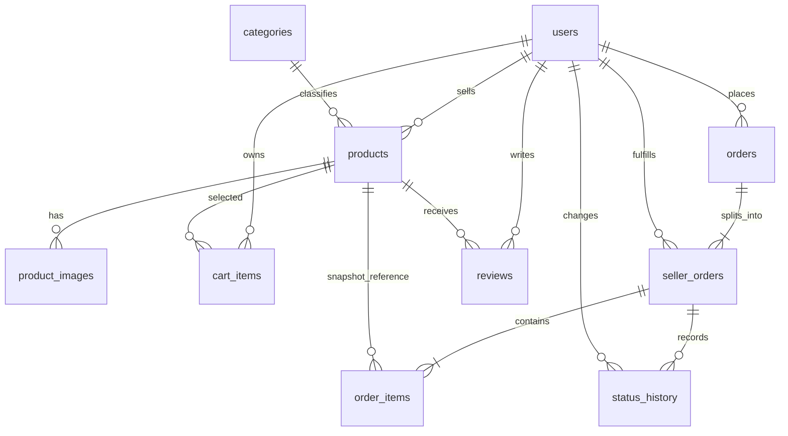

# Shuka database design

## Engine and invariants

- SQLite 3.37+ and `better-sqlite3`; all business tables use `STRICT` typing.
- Every connection enables foreign keys, WAL, and a 5000 ms busy timeout.
- Monetary values are integer AMD; timestamps are ISO-8601 UTC text.
- Foreign-key deletion rules preserve order history. Products referenced by carts or order items cannot be deleted.
- `status_history` is append-only, enforced by SQLite triggers.
- `users.email` is case-insensitively unique. `users.store_name` is unique when non-NULL.
- `orders` uses `UNIQUE(buyer_id, request_key)` for buyer-scoped checkout idempotency.
- `reviews` uses `UNIQUE(buyer_id, product_id)` for one review per buyer/product.
- Product images are paths and metadata only; binary data lives on disk.

## Core entities and relationships

### Table notes

1. `users`: buyer and seller identity; `store_name` remains NULL until seller activation.
2. `categories`: normalized product taxonomy.
3. `products`: seller-owned listing, inventory, publication and rating aggregate.
4. `product_images`: filesystem paths, dimensions, MIME type and primary-image selection.
5. `cart_items`: one row per user/product, including the price snapshot captured when added.
6. `orders`: buyer-level checkout and immutable delivery-recipient/address snapshot.
7. `seller_orders`: one fulfillment unit per seller within a parent order.
8. `order_items`: immutable purchase-time title, unit price, quantity and line total.
9. `status_history`: append-only status transition audit log.
10. `reviews`: one rating per buyer/product; delivered-purchase eligibility is enforced in the service layer.

`sessions` is an additional infrastructure table for server-side session persistence, not an eleventh core marketplace table. `admins` is an additional access-control table; membership is provisioned by an operator and cannot be granted through public registration. `schema_migrations` tracks applied SQL migration filenames.

## Transaction boundaries

- Checkout, seller-order transitions, cancellation/restocking and review aggregate updates must use short `BEGIN IMMEDIATE` transactions.
- Image decoding, resizing and filesystem operations must happen outside database transactions.
- SQLite cannot enforce every cross-table business invariant with simple CHECK constraints. Ownership, delivered-review eligibility, allowed status transitions and seller/buyer access are service-layer invariants backed by integration tests.

## Migration policy

Migration filenames are monotonically numbered (`NNN_description.sql`). Applied filenames are recorded in `schema_migrations`. Migrations are immutable after release; schema changes require a new migration.
